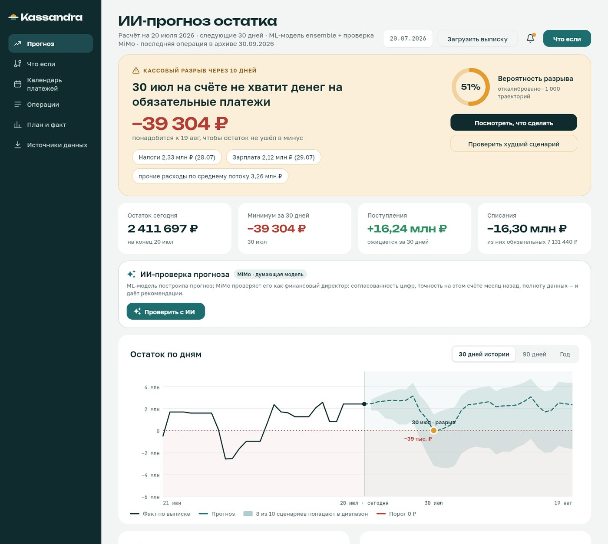
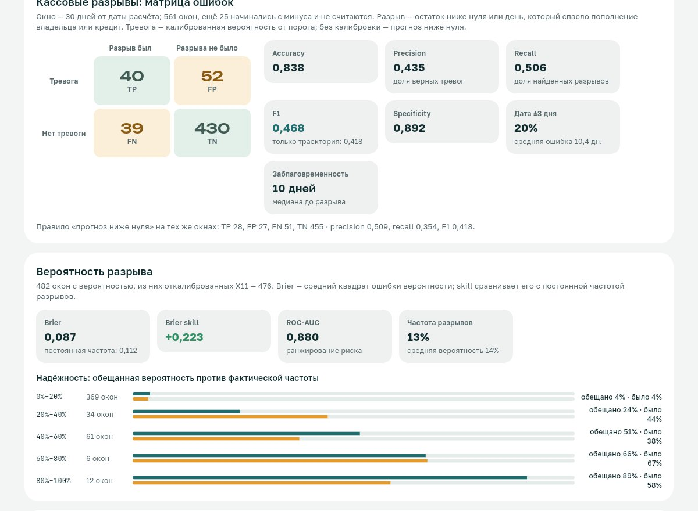
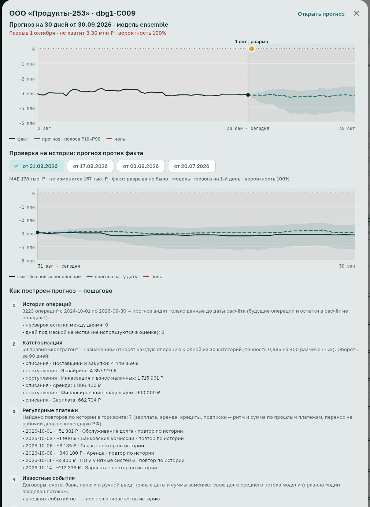
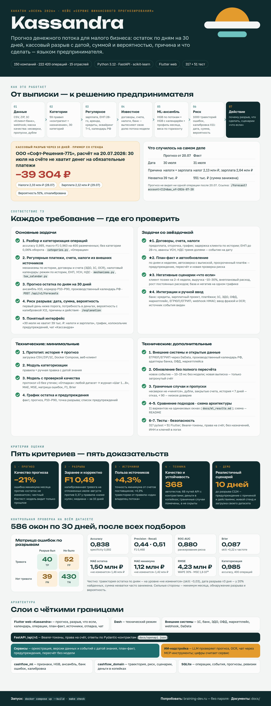
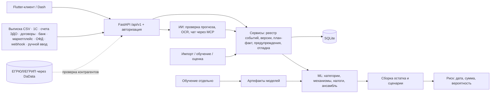

<div align="center">

<picture>
  <source media="(prefers-color-scheme: dark)" srcset="apps/kassandra_app/assets/logo/lockup-dark.png">
  
</picture>

### Прогноз денежного потока и кассовых разрывов для малого бизнеса

Остаток на 30 дней вперёд, разрыв — с датой, суммой и вероятностью, причина и что сделать.<br>
Решение кейса хакатона «Осень 2026».

[](https://github.com/omazda/Kassandra/actions/workflows/ci.yml)


**[▶ Попробовать](https://braining-dev.ru)** · [Сценарии](#попробовать) · [Соответствие ТЗ](#соответствие-требованиям-кейса) · [Метрики](#качество) · [Запуск](#запуск) · [Архитектура](#архитектура)

</div>

<p align="center"></p>

## Попробовать

> [!TIP]
> Стенд https://braining-dev.ru открыт без пароля. Данные — синтетические выписки хакатона (150 компаний), всё, что вы добавите, видят другие посетители.

| Что посмотреть | Ссылка |
|---|---|
| Разрыв, предупреждённый за 10 дней: причины, действия, вероятность | [C124 на 20.07.2026](https://braining-dev.ru/forecast?account=C124&as_of=2026-07-20) |
| Разрыв, предсказанный за три недели (факт — на день раньше) | [C004 на 11.05.2026](https://braining-dev.ru/forecast?account=C004&as_of=2026-05-11) |
| Сценарии «что если»: задержка клиента, падение выручки, рост расходов | [Что если](https://braining-dev.ru/scenarios?account=C124&as_of=2026-07-20) |
| Календарь платежей: добавить счёт, договор или налог и увидеть новый прогноз | [Календарь](https://braining-dev.ru/calendar?account=C124&as_of=2026-07-20) |
| Загрузить свой датасет и получить прогноз, журнал расчёта и метрики | [Отладка](https://braining-dev.ru/debug) |
| Спросить ИИ-помощника «Кассандра» | кнопка в правом нижнем углу любой страницы |

Внизу страницы прогноза есть блок «Как построен прогноз — пошагово»: 8 шагов от выписки до действий.

<table>
<tr>
<td width="50%"></td>
<td width="50%"></td>
</tr>
<tr>
<td align="center">Метрики на загруженном датасете</td>
<td align="center">Прогноз против факта и журнал расчёта</td>
</tr>
</table>

## Возможности

- **Категоризация операций** — 59 правил «контрагент + назначение», 30 категорий, ручная правка с датой знания.
- **Регулярные платежи и налоги** — зарплата (аванс и расчёт), ЕНП 28-го, аренда, кредиты и лизинг, эквайринг T+1, производственный календарь РФ. Налоговый режим выводится из истории: ЕНП, авансы УСН, НДС тремя долями.
- **Прогноз остатка на 30 дней** — ансамбль из трёх методов (HGB по потокам, HGB с календарём, профиль месяца) с весами по горизонту и коридором P10–P90.
- **Риск кассового разрыва** — первый день ниже порога, сумма нехватки и вероятность: 1000 траекторий из банка прошлых ошибок плюс изотоническая калибровка. Причины («налоги 2,33 млн ₽ 28.07 и зарплата») и действия: предоплата, овердрафт, резерв, перенос платежа.
- **Дополнительные источники** — договоры, счета (ЭДО, 1С, OCR), налоговый календарь, банк (кредиты, зарплатный проект, платёжки), маркетплейс, онлайн-касса, ЕГРЮЛ/ЕГРИП, webhook с подписью HMAC, ручной ввод фразой. Известное событие вытесняет свою долю среднего потока модели, без двойного учёта.
- **План-факт и пересчёт** — сверка ожиданий с выпиской, просрочки, пересчёт без запуска модели (~10–15 мс).
- **Сценарии «что если»** — задержка крупного клиента на 2–4 недели, падение выручки на 10–30%, внеплановый расход, рост постоянных расходов.
- **Проверка на любом датасете** — страница «Отладка»: загрузка файла, пошаговый журнал расчёта, MAE, MSE, матрица ошибок, precision, recall, F1, Brier, ROC-AUC, графики «прогноз против факта», отчёт в Markdown.
- **ИИ-помощник** — LLM проверяет прогноз и даёт рекомендации, распознаёт документы и отвечает в чате «Кассандра» через MCP-инструменты. Цифры считает сервис, а LLM их объясняет; без ключа LLM сервис работает полностью.

## Соответствие требованиям кейса

Постер — как работает сервис и где проверить каждое требование (исходник — `docs/poster/poster.html`):

<p align="center"><a href="docs/poster.png"></a></p>

Все ссылки в таблице — эндпоинты API (`/api/v1/...`), полный контракт — `docs/openapi.json`, описание — `docs/contracts.md`.

| Требование | Как закрыто | Ограничения |
|---|---|---|
| 1. Разбор и категоризация | Правила по шаблону контрагента и назначения; ручная правка с датой знания. `GET /dictionaries`, `GET /accounts/{id}/transactions`, `PATCH /transactions/{account}/{op}/category`, `GET /accounts/{id}/categories/summary` | accuracy 0,985 и macro-F1 0,963 на 400 размеченных операциях; разметка одного автора |
| 2. Регулярные платежи, счета, налоги из внешних источников | `GET /accounts/{id}/recurring`; `GET /accounts/{id}/tax-calendar` (режим, ЕНП 28-го, авансы УСН, НДС) + `POST .../tax-calendar/apply`; счета — `POST /accounts/{id}/invoices`, `POST /accounts/{id}/imports/invoices` | режим налогообложения выводится по истории, точность без меток не измерена |
| 3. Прогноз остатка по дням ≥ 30 дней | `POST /forecasts`: 30 дней, ансамбль X10 (по умолчанию), а также constant, weekday, hgb, structural; бэктест по протоколу v3 | траектория по дням — на уровне «остаток не изменится»; выигрыш — в минимуме месяца |
| 4. Риск: дата, сумма, вероятность | `risk.first_gap_date`, `liquidity_need_minor`, `probability_30d`, `alarm`; стресс-оценка `risk.stress`; объяснение `GET /forecasts/{id}/explanation`; журнал расчёта `GET /forecasts/{id}/trace`; предупреждения `GET /accounts/{id}/alerts` | калибровка вероятности действует с 24.06.2026; для более ранних дат — сырая частота траекторий |
| 5. Понятный интерфейс | Flutter-клиент: прогноз, разрыв, что если, календарь платежей, операции, план-факт, источники, отладка, чат; Dash — технический режим | — |
| ★1. Договоры, счета, налоги | `POST /accounts/{id}/contracts` (предоплата, отсрочка, рассрочка, график); счета со сроком оплаты и типичной задержкой клиента; налоговый календарь. Правило «один владелец потока» (`forecast.netting`) | без истории оплат по документам задержка = срок оплаты |
| ★2. План-факт и обновление | `GET /plan-fact?granularity=day\|week`; автосверка реестра с выпиской и `POST /accounts/{id}/reconcile`; просроченное обязательство остаётся в прогнозе (`forecast.overdue_events`); `POST /forecasts/{id}/refresh` пересчитывает и заново проверяет риск | — |
| ★3. Сценарии «что если» | `POST /scenarios/evaluate`: `client_delay`, `revenue_drop`, `extra_expense`, `fixed_cost_increase`, `combined`; база и негатив на одном графике | — |
| ★4. Интеграции и ручной ввод | банк — `POST /accounts/{id}/integrations/bank`; 1С «Клиент-банк» — `POST /accounts/{id}/imports/1c`; счета ЭДО/1С — `imports/invoices`; маркетплейс и онлайн-касса — `integrations/marketplace`, `integrations/ofd`; ЕГРЮЛ/ЕГРИП — `GET /counterparties/{inn}/check`, `GET /accounts/{id}/counterparty-risks`; webhook — `POST /api/v1/hooks/{id}`; ручной ввод — `POST /events`, `POST /events/parse`; OCR — `POST /ai/ocr` | живых подключений к банку, маркетплейсу и ОФД нет: эндпоинты принимают данные в формате адаптера, примеры — `examples/`; реестр — при `DADATA_API_KEY` |
| Тех. мин. 1–4 | прототип принимает CSV/ZIP/1С и выдаёт прогноз; модуль категоризации; модель с проверкой качества (протокол v3 и «Отладка»); график остатка и список предупреждений | — |
| Тех. доп. 1. Внешние системы и открытые данные | см. ★4; производственный календарь РФ 2024–2027. Польза измерена без утечки: счета поставщиков уточняют минимум остатка на 4,3% [+1,6; +8,3]; вытеснение вместо сложения — +4,9% по траектории на ретро (`experiments/results/v3/sources/report.md`) | на ретро для HGB эффекта по минимуму нет |
| Тех. доп. 2. Обновление без полного пересчёта | новое событие — пересборка траектории без модели (~10–15 мс); новая выписка — пересчёт только затронутого счёта, без переобучения | — |
| Тех. доп. 3. Граничные случаи и пропуски | маска качества (несверки и пропуски не «чинятся»), дубли, закрытые счета, уровень доверия, отказ при истории < 7 дней | — |
| Тех. доп. 4. Сравнение подходов | протокол v3: 11 вариантов на одинаковых окнах, бутстрэп по компаниям — `docs/ml_results.md` | — |
| Тех. доп. 5. Схема архитектуры | раздел «Архитектура» ниже | — |
| Тех. доп. 6. Тесты | `make check`: ruff и 318 тестов, каждый эндпоинт — против своей модели ответа; Flutter — 51 тест с эталонными снимками; браузерные проверки Playwright | — |
| Тех. доп. 7. Безопасность | Bearer-токены, права на счёт, пароль интерфейса; назначения платежей, ИНН и ключи не попадают в логи; webhook с подписью | — |

## Качество

Протокол — `docs/ml_protocol.md`, результаты — `docs/ml_results.md`, реестр экспериментов — `experiments/registry.json`.

- Модель никогда не видит будущего. Модели обучены на данных до 31.12.2025, веса ансамбля подобраны до 28.02.2026. Метод выбирается на срезах март–май 2026, а июль–август — только отчёт.
- **Цель D3** — остаток без новых пополнений владельца и кредитов после даты расчёта. **Метка D2** — отрицательный остаток или день, который спасло такое пополнение.

| Метод (выбор: 14 срезов, 1539 окон, 121 компания) | Skill траектории | Skill минимума | Разрывов найдено (дата ±3 дня) |
|---|---:|---:|---:|
| «Остаток не изменится» | 0 | 0 | 0 из 69 |
| Профиль по дням недели | −0,088 | +0,076 | 8 из 69 |
| HGB по потокам | −0,003 | +0,157 | 17 из 69 |
| Профиль месяца | −0,014 | +0,304 | 15 из 69 |
| Структурная по механизмам | −0,058 | +0,203 | 20 из 69 |
| **Ансамбль X10 (в продукте)** | **+0,020** [−0,002; +0,037] | **+0,244** [+0,218; +0,293] | 13 из 69 |

На ретро у ансамбля: +0,027 [+0,016; +0,048] по траектории, +0,284 по минимуму.

**Тревога о разрыве (X11).** Изотоническая калибровка и порог 26% подобраны на марте–мае; июль–август проверены один раз:

| Ретро: 583 окна, 69 разрывов | Precision | Recall | F1 | Brier |
|---|---:|---:|---:|---:|
| Прогноз ниже нуля | 0,477 | 0,304 | 0,372 | 0,114 |
| **Калиброванная вероятность ≥ 26%** | 0,442 | 0,551 | **0,490** | **0,083** |

**Контрольная проверка на всём датасете** (страница «Отладка»: 586 окон июль–сентябрь 2026, 148 компаний, после всех подборов):

| Метрика | Значение |
|---|---|
| Матрица ошибок по разрывам | TP 40 · FP 52 · FN 39 · TN 430 |
| Accuracy / Precision / Recall / F1 | 0,838 / 0,435 / 0,506 / 0,468 |
| Вероятность | Brier 0,087 (skill +0,22), ROC-AUC 0,880 |
| MAE остатка / RMSE | 1,50 млн ₽ / 4,23 млн ₽ (у «не изменится» 1,46 / 4,14) |
| MAE минимума месяца | 1,12 млн ₽ против 1,42 млн ₽ — на 21% точнее |

Ограничения:

- траектория остатка по дням не лучше константы;
- дата разрыва ±3 дня угадывается у 20% найденных разрывов;
- сумма нехватки часто занижена.

## Запуск

Проверено на Linux, 4 CPU, 9 ГБ RAM. Нужен [uv](https://docs.astral.sh/uv/getting-started/installation/) (он сам поставит Python 3.12) или Docker с Compose v2. Распакованный архив организаторов кладётся в папку `dataset/` в корне проекта (читаются `dataset/all_operations.csv` и `dataset/companies.csv`).

### Локально

```bash
uv sync --frozen --extra dev                     # зависимости
uv run cashflow bootstrap --dataset dataset/     # ~1 мин: .env с токеном, импорт 150 компаний, обучение HGB
uv run cashflow build-error-bank                 # ~1,5 мин: банк ошибок для вероятности разрыва
uv run cashflow build-ensemble                   # ~1,5 мин: веса ансамбля X10
uv run cashflow build-calibration                # ~3 мин: вероятность и P10/P90 структурной модели
uv run python scripts/dev.py                     # API + технический интерфейс; Ctrl-C — остановить
```

API и OpenAPI: http://127.0.0.1:8000/docs, технический интерфейс Dash: http://127.0.0.1:8050. Другие порты: `API_PORT=8100 DASH_PORT=8150 uv run python scripts/dev.py`. То же через make: `make setup demo calibrate run`.

`bootstrap` создаёт `.env` с локальным токеном, только если файла ещё нет; повторный запуск безопасен. Калибратор тревоги X11 поставляется с пакетом (`src/cashflow_ml/gap_alarm.json`); пересобрать его — `experiments/results/v3/x11_gap_alarm/build_x11.py`.

### Docker

```bash
docker compose up --build
```

Первый запуск: сборка ~4 мин, затем контейнер `initialize` (~6 мин) импортирует данные и обучает модели, после чего стартуют API и Dash. Данные и токен живут в volume `cashflow-state`; полный сброс — `docker compose down -v`.

### Веб-клиент (Flutter)

```bash
cd apps/kassandra_app
flutter run -d chrome --dart-define=KASSANDRA_DATA=http --dart-define=API_BASE_URL=http://127.0.0.1:8000
flutter build web --release --dart-define=KASSANDRA_DATA=http --dart-define=API_BASE_URL=/
```

Без `KASSANDRA_DATA=http` клиент работает на встроенной фикстуре без сети. Веб-сборка отдаётся с того же адреса, что и API; пример nginx — `deploy/nginx.conf`. Подробно — `apps/kassandra_app/README.md`.

### Проверка

```bash
make check                                       # ruff + pytest
uv run cashflow evaluate-v3                      # бэктест v3 → experiments/results/v3/protocol/
(cd apps/kassandra_app && flutter analyze && flutter test)
```

| Симптом | Что сделать |
|---|---|
| Порт 8000 занят | задать `API_PORT` / `DASH_PORT` |
| «Нет обученной модели» | выполнить `bootstrap` или `uv run cashflow train` |
| Вероятность «недоступна» | `uv run cashflow build-error-bank`; для структурной модели — `build-calibration` |
| Начать заново | удалить `data/`, `artifacts/` и `.env`, повторить `bootstrap` |

## Доступ и настройки

- API проверяет право на конкретный счёт, прогноз, событие и сценарий. `CASHFLOW_USERS_JSON` имеет формат `{"<token>": {"id": "alice", "accounts": ["C001"]}}`. Режим `CASHFLOW_AUTH_MODE=demo` без токена показывает только помеченные синтетические счета.
- Сырые платёжные тексты, ИНН, ключи и реквизиты не пишутся в журналы.
- LLM включается в `.env`: `LLM_ENABLED=true`, `LLM_API_KEY`, `LLM_BASE_URL`, `LLM_MODEL_ID` (пример — `.env.example`); любой OpenAI-совместимый провайдер. Роли, инструкции и лимиты — `docs/ai.md`. Без ключа `/api/v1/ai/*` отвечают 503, остальное работает.
- Для OCR нужны `tesseract-ocr`, `tesseract-ocr-rus` и `poppler-utils`; в Docker-образе они есть.
- Страница «Отладка» (загрузка своего датасета и расчёт метрик) включается переменной `CASHFLOW_DEBUG_DATASETS=true`; в Docker Compose — `DEBUG_DATASETS=true`.

## Архитектура



| Путь | Назначение |
|---|---|
| `src/cashflow_domain/` | Pydantic-контракты, сборка траектории, риск, сценарии, объяснения; деньги — целые копейки |
| `src/cashflow_ml/` | признаки, HGB, ансамбль, механизмы, налоговый календарь, банк ошибок, калибровка, протокол v3 |
| `src/cashflow_services/` | оркестрация, SQLite, импорт и категоризация, источники, webhook, отладка, LLM и MCP, CLI |
| `apps/api/` | FastAPI |
| `apps/kassandra_app/` | Flutter-клиент |
| `apps/dashboard/` | Dash — технический режим |
| `experiments/` | протоколы, реестр экспериментов, результаты и скрипты прогонов |
| `docs/` | постер, продукт, протокол, результаты, контракты API, ИИ |
| `examples/` | примеры данных для интеграций |
| `tests/` | pytest и браузерные проверки |

Документы:

- [Продукт и ограничения](docs/product_spec.md)
- [Протокол обучения и проверки](docs/ml_protocol.md)
- [Результаты](docs/ml_results.md)
- [Контракты API](docs/contracts.md)
- [ИИ-помощник](docs/ai.md)

## Разработка

- Стиль Python — ruff (длина строки 100), Dart — `flutter analyze`. Деньги — только целые копейки (`*_minor`), без float.
- Любая логика ML и предметной области — с тестом в `tests/`. Перед коммитом — `make check` и `flutter test`; CI проверяет то же на каждый push и pull request.
- Новый эксперимент — запись в `experiments/registry.json` и раздел в `docs/ml_results.md`; результаты прошлых прогонов не перезаписываются.
- Уязвимости — по правилам из [SECURITY.md](SECURITY.md).

## Команда

Oleg Manzyak ([@omazda](https://github.com/omazda)), Matvey.
