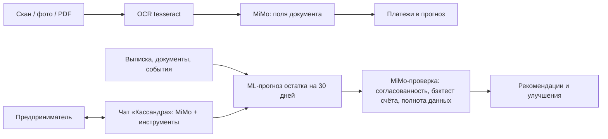

# ИИ в Kassandra: ML-прогноз + MiMo

Прогноз строит ML-модель — ансамбль X10 (`model=ensemble`; см. `docs/ml_results.md`, `docs/presentation_metrics.md`). Поверх неё работает думающая LLM **Xiaomi MiMo** (`mimo-v2.6-flash`, OpenAI-совместимый API; до 24.10.2026 была MiMo). Модель не придумывает цифры: она получает их из сервиса — компактным JSON или через инструменты — и объясняет, проверяет и действует.

## Роли и инструкции

Инструкции — в `src/cashflow_services/prompts/`, по одной на роль:

| Файл | Роль | Где в интерфейсе |
|---|---|---|
| `reviewer.md` | Контролёр качества ИИ-прогноза и советник: 6 проверок (согласованность цифр, точность модели на этом счёте месяц назад, полнота данных, обязательные платежи, надёжность поступлений, неопределённость), 2–4 рекомендации с суммой и сроком, 1–3 способа сделать прогноз точнее | «Прогноз» → карточка «ИИ-проверка прогноза» |
| `model_review.md` | ML-ревьюер: по проверкам всех компаний набора оценивает качество ИИ-прогноза, находит закономерности в худших компаниях и предлагает улучшения модели с ожидаемым эффектом и способом честной проверки | «Отладка» → «Разбор модели — MiMo» |
| `agent.md` | Ассистент-агент: отвечает на вопросы и сам выполняет действия в сервисе через инструменты | Кнопка «Спросить Кассандру» на всех экранах |
| `ocr.md` | Разбор первичных документов после OCR: тип, номер, стороны, сумма, срок, график платежей, направление денег относительно нашей компании | «Источники данных» → «Счёт или договор», «Новое событие» → «Из документа» |

Общие правила во всех инструкциях: модель думает на английском (так точнее и меньше путаницы языков), отвечает только по-русски; цифры только из данных, просто, ответ — строгий JSON по схеме (кроме чата), при нехватке данных — сказать об этом.

## Проверка результатов ИИ

Для каждого прогноза сервис сам считает честный бэктест этого счёта (`account_backtest`): та же модель строит прогноз за 30 дней до даты расчёта, сравнение — с фактическими остатками до даты расчёта (будущее не используется). MiMo получает MAE модели и простого прогноза «остаток не меняется», минимумы и даты разрыва и по ним решает, насколько доверять текущему прогнозу. Вердикт: `ok` — можно опираться, `caution` — с оговорками, `weak` — только ориентир.

## MCP-коннекторы (чтение данных системы)

`src/cashflow_services/mcp_server.py` — MCP-сервер (Model Context Protocol, спецификация 2025-06-18, Streamable HTTP с JSON-ответами): `POST /api/v1/mcp` принимает JSON-RPC 2.0 — `initialize`, `tools/list`, `tools/call`, `ping`; уведомления → 202. Доступ — как у API (Bearer-токен или демо-режим). Все 15 инструментов только читают (`readOnlyHint`), проверяют права на счёт и отдают суммы в рублях:

`get_accounts`, `get_account_overview`, `get_forecast`, `get_gap_explanation`, `get_payment_calendar`, `get_transactions`, `get_category_summary`, `get_top_clients`, `get_recurring_payments`, `get_tax_calendar`, `get_plan_fact`, `get_alerts`, `get_counterparty_risks`, `get_balance_history`, `get_model_quality`.

Чат-агент берёт описания этих инструментов из MCP-сервера (`openai_tools`) и вызывает их в том же процессе — тот же код, что отвечает внешним MCP-клиентам. Счёт, дата расчёта и текущий расчёт подставляются с экрана пользователя, если модель их не указала. Пример подключения внешнего клиента: адрес `https://<ваш-домен>/api/v1/mcp`, транспорт Streamable HTTP, заголовок basic auth стенда.

## Чат-агент: инструменты

Чтение — MCP-коннекторы выше; действия — `run_scenario`, `add_payment`, `cancel_payment`, `apply_tax_calendar`, `review_forecast`, `switch_account`, `open_page`. Инструменты выполняются на сервере с правами пользователя (`authorize`); изменения данных — ревизиями с `known_at` = дата расчёта. Клиент получает список выполненных действий и команды экрану (`navigate`, `switch_account`, `refresh`) и выполняет их сам. Не больше 8 вызовов инструментов на вопрос.

Ответ считается в фоне: `POST /api/v1/ai/chat/jobs` возвращает `job_id`, `GET /api/v1/ai/chat/jobs/{job_id}` — статус, этап («Платёжный календарь…»), выполненные шаги, мысли модели и время. Чат показывает живой счётчик «Кассандра думает · 7,4 с», этап и мысли, под ответом — «Думала 14,2 с». Карточка ИИ-проверки тоже показывает секунды, пока модель думает.

## OCR

PNG/JPEG/PDF/текст до 15 МБ. PDF с текстовым слоем — `pdftotext`; скан — `pdftoppm` + `tesseract -l rus+eng`; изображение — `tesseract`. Если текста меньше 40 символов, MiMo читает изображение сама (vision). Направление денег определяется по нашей компании (название счёта и ИНН из `companies.csv`). Результат — черновики платежей; пользователь проверяет направление и дату и добавляет их в прогноз.

## API

| Метод | Путь | Ответ |
|---|---|---|
| GET | `/api/v1/ai/status` | включён ли ИИ, модель, вызовов и расход за день |
| GET | `/api/v1/ai/forecasts/{run_id}/review` | сохранённая проверка или `null` (бесплатно) |
| POST | `/api/v1/ai/forecasts/{run_id}/review?refresh=` | проверка и рекомендации (кэш по расчёту) |
| POST | `/api/v1/ai/debug/{dataset_id}/review` | разбор модели по проверкам набора |
| POST | `/api/v1/ai/ocr` | multipart `file`, `account_id` → поля и черновики платежей |
| POST | `/api/v1/ai/chat` | `{messages, context}` → ответ, действия, команды экрану |

ИИ выключен или недоступен → 503 с понятным текстом; остальной сервис работает без MiMo.

## Настройка и стоимость

Переменные (`.env` локально, `.env.deploy` на стенде; в Git не попадают): `LLM_ENABLED=true`, `LLM_API_KEY`, `LLM_BASE_URL=https://token-plan-sgp.xiaomimimo.com/v1`, `LLM_MODEL_ID=mimo-v2.6-flash`; необязательные — `LLM_REASONING_EFFORT` (по умолчанию `low`), `LLM_MAX_TOKENS` (6000), `LLM_TIMEOUT_SECONDS` (120), `LLM_DAILY_TOKENS` (3 000 000 — после него вызовы останавливаются до следующего дня; MiMo не сообщает стоимость, поэтому лимит по токенам).

Замеры 24.10.2026 на MiMo: проверка прогноза ≈ 6 тыс. токенов и до минуты (кэшируется по содержанию расчёта); вопрос в чат ≈ 3–5 тыс. токенов и 10–20 с; документ ≈ 1,5 тыс. токенов и 10–15 с. Без `reasoning_effort=low` рассуждения могут съесть весь лимит токенов.

MiMo иногда вставляет в русский ответ китайское слово: инструкции это запрещают, а `clean_text` в `llm.py` вырезает иероглифы из ответа.

Журнал пишет только код ответа, время, токены и стоимость — без текстов запросов и ответов и без ключа.
